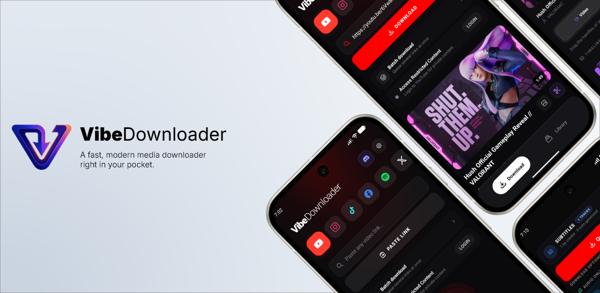
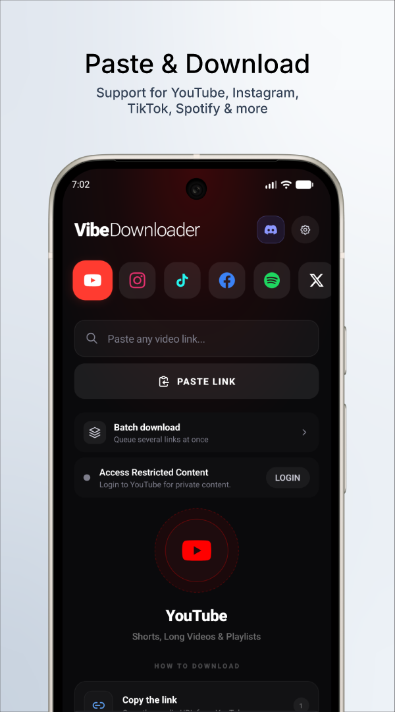
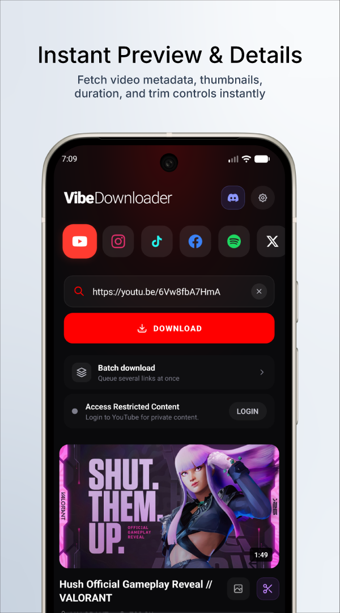
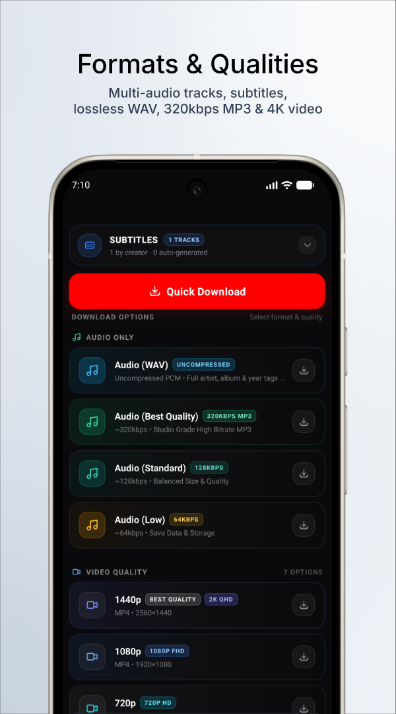
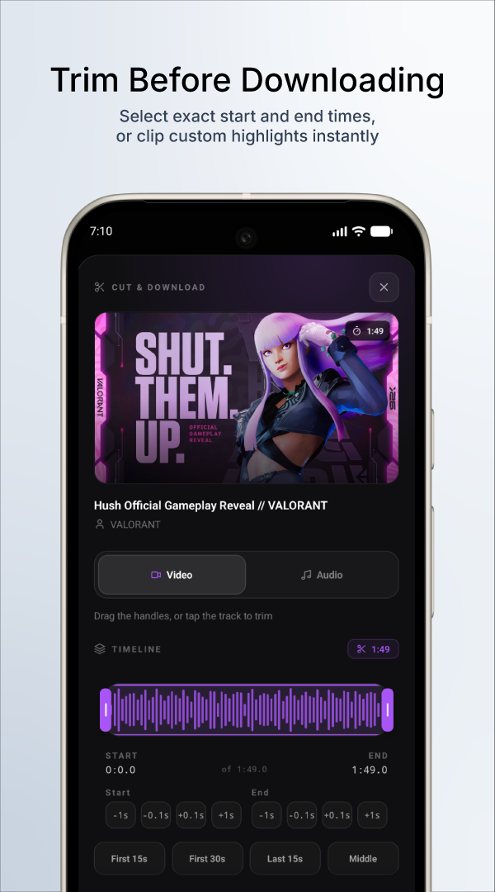
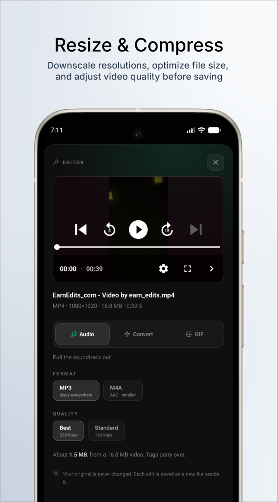
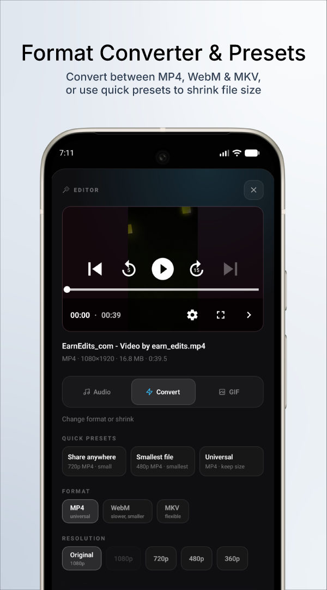
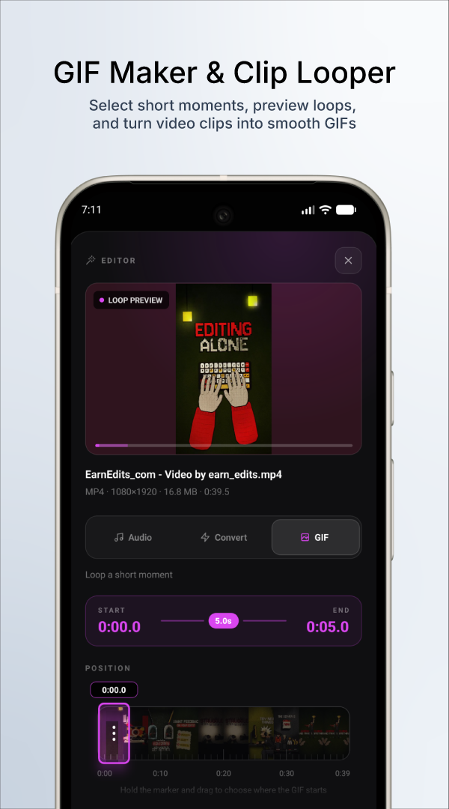
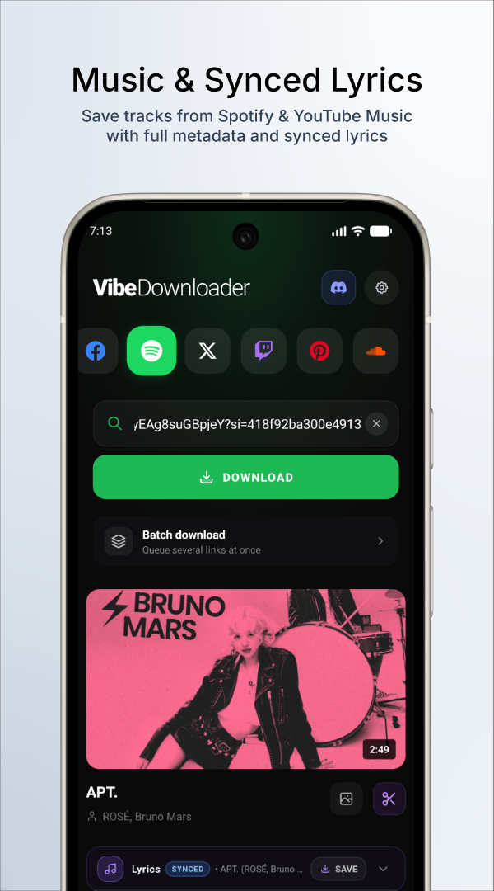
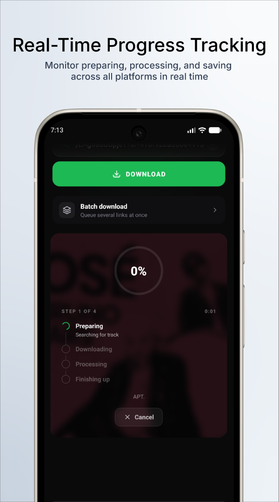

<div align="center">
  

  # VibeDownloader for Android

  ### Free, fast & private video and music downloader for your phone
</div>

<br />

<div align="center">

**Download videos, audio, subtitles, lyrics and playlists from YouTube, Instagram, TikTok, Spotify and more.**
<br />
Local. Ad-free. Private by design. Powered by `yt-dlp` & QuickJS.

<sub>A free, open-source YouTube downloader, Spotify saver, TikTok, Instagram, Facebook and Twitch media downloader for Android. Features background batch downloads, Gallery integration, lyrics, and trim before save. Also on Windows, macOS, Linux, and Adobe Premiere Pro.</sub>

<br />

<a href="https://github.com/naeem5877/vibedownloader-android/releases/latest"></a>
<a href="https://github.com/naeem5877/vibedownloader-desktop/releases/latest"></a>
<a href="https://github.com/naeem5877/vibe-plugin/releases/latest"></a>

<a href="https://github.com/naeem5877/vibedownloader-android/releases/latest"></a>
<a href="https://github.com/naeem5877/vibedownloader-android/releases"></a>
<a href="https://github.com/naeem5877/vibedownloader-android/stargazers"></a>
<a href="LICENSE"></a>
<a href="https://vibedownloader.me"></a>

<br />

[Quick start](#quick-start) · [Features](#features) · [Platforms](#platforms) · [Screenshots](#see-it) · [Install](#install) · [What's New](#whats-new) · [Desktop](#desktop) · [Premiere](#premiere-plugin) · [Help](#troubleshooting) · [Develop](#develop)

</div>


<a id="why"></a>

## 🌟 Why VibeDownloader?

<table>
<tr>
<td width="33%" valign="top">

### 🔒 Private by design
Everything runs **directly on your phone**. No accounts, no ads, and no tracking of what you download. Your downloads stay yours.

</td>
<td width="33%" valign="top">

### ⚡ Powered by yt-dlp & QuickJS
Industry-standard engine with embedded CPython, plus an on-device QuickJS engine to solve YouTube challenges instantly without slow retries.

</td>
<td width="33%" valign="top">

### 🎛️ Full control
Pick the exact video quality (up to 4K), audio bitrate, language track, format, or clip range before saving.

</td>
</tr>
</table>

<a id="quick-start"></a>

## 🚀 Quick Start

Three simple steps to save your media.

<table>
<tr>
<td width="33%" valign="top">

### 1️⃣ Install
Download the matching `.apk` for your phone from [**Releases**](https://github.com/naeem5877/vibedownloader-android/releases/latest) and tap install.<br />
[Step-by-step install guide →](#install)

</td>
<td width="33%" valign="top">

### 2️⃣ Paste or share a link
Copy a link and paste it into the app, or tap **Share** in YouTube, Instagram, TikTok or Spotify and choose **VibeDownloader**.

</td>
<td width="33%" valign="top">

### 3️⃣ Choose & save
Select your quality, audio language or format, optionally trim with clip handles, and download straight to your Gallery and Music library.

</td>
</tr>
</table>


<a id="see-it"></a>

## 🖼️ See It in Action

### 📸 Screenshots

<table>
<tr>
<td width="33%" align="center" valign="top"><br /><sub><b>Paste & Download</b><br />Support for YouTube, Instagram, TikTok, Spotify &amp; more</sub></td>
<td width="33%" align="center" valign="top"><br /><sub><b>Instant Preview & Details</b><br />Video metadata, thumbnails, duration and trim controls</sub></td>
<td width="33%" align="center" valign="top"><br /><sub><b>Formats & Qualities</b><br />Multi-audio, subtitles, lossless WAV, 320kbps MP3 &amp; 4K</sub></td>
</tr>
<tr>
<td width="33%" align="center" valign="top"><br /><sub><b>Trim Before Downloading</b><br />Select exact start and end times or clip highlights</sub></td>
<td width="33%" align="center" valign="top"><br /><sub><b>Resize & Compress</b><br />Downscale resolution and optimize file size</sub></td>
<td width="33%" align="center" valign="top"><br /><sub><b>Format Converter & Presets</b><br />MP4, WebM &amp; MKV, or quick presets to shrink files</sub></td>
</tr>
<tr>
<td width="33%" align="center" valign="top"><br /><sub><b>GIF Maker & Clip Looper</b><br />Turn short video moments into smooth GIFs</sub></td>
<td width="33%" align="center" valign="top"><br /><sub><b>Music & Synced Lyrics</b><br />Spotify &amp; YouTube Music with lyrics</sub></td>
<td width="33%" align="center" valign="top"><br /><sub><b>Real-Time Progress Tracking</b><br />Preparing, processing and saving, live</sub></td>
</tr>
</table>


<a id="features"></a>

## ✨ Features

Everything VibeDownloader for Android can do, built specifically for mobile convenience.

### 📥 Download & Share

<table>
<tr>
<td width="50%" valign="top">

**📲 Share to Download**<br />
Tap Share in YouTube, Instagram, TikTok, Facebook or Spotify, choose VibeDownloader, and the link fetches automatically.

</td>
<td width="50%" valign="top">

**📦 Redesigned Batch Downloads**<br />
Queue multiple links with platform badges, remove individual URLs, paste more links on the fly, and monitor live preparation progress.

</td>
</tr>
<tr>
<td valign="top">

**📖 Instagram & Facebook Stories**<br />
Download public and friend stories directly to your phone with dedicated story extraction.

</td>
<td valign="top">

**🔴 Twitch Live Streams & VODs**<br />
Record ongoing live broadcasts until you stop, auto-muxed into playable MP4 files upon completion.

</td>
</tr>
</table>

### 🎵 Music, Lyrics & Subtitles

<table>
<tr>
<td width="50%" valign="top">

**🎧 Studio-Quality Music**<br />
Save songs as MP3 or uncompressed WAV with embedded track names, album titles, artists, and original album artwork.

</td>
<td width="50%" valign="top">

**🎤 Synchronized Lyrics**<br />
Save lyrics for Spotify and YouTube Music: line-by-line synced, word-by-word karaoke, plain text, or translated.

</td>
</tr>
<tr>
<td valign="top">

**💬 Subtitles (SRT)**<br />
Download multi-language closed captions and subtitles from YouTube as standard `.srt` files.

</td>
<td valign="top">

**🌍 Multi-Language Audio Tracks**<br />
Choose the specific audio language track for multi-dubbed videos, and save as either audio-only or a video with that audio stream.

</td>
</tr>
</table>

### ✂️ Edit & Organization

<table>
<tr>
<td width="50%" valign="top">

**✂️ Cut & Download**<br />
Trim any video or audio before downloading using touch-friendly waveform handles. Downloads only the selected range.

</td>
<td width="50%" valign="top">

**📂 Smart In-App Library**<br />
View downloaded media categorized by platform (YouTube, Spotify, etc.) with real thumbnails, storage meters, and quick actions.

</td>
</tr>
<tr>
<td valign="top">

**🖼️ System Gallery Integration**<br />
Downloaded videos and images automatically register in your phone's Gallery app via MediaStore, and music appears in your music player.

</td>
<td valign="top">

**💾 Storage Flexibility**<br />
Choose between internal storage and external SD cards with transparent Android scoped-storage handling.

</td>
</tr>
</table>

### ⚡ Android Native & Convenience

<table>
<tr>
<td width="50%" valign="top">

**🚀 QuickJS Hardware Acceleration**<br />
An embedded JavaScript engine executes YouTube signature challenges locally in milliseconds, drastically cutting wait times.

</td>
<td width="50%" valign="top">

**📡 Offline Mode with Library Access**<br />
When connection drops, an offline banner appears with a direct shortcut to your local Library, automatically reconnecting when online.

</td>
</tr>
<tr>
<td valign="top">

**🔔 Rich In-App Updates**<br />
Check for updates right in the app with formatted release notes, download sizes, and automatic detection of your device's CPU architecture.

</td>
<td valign="top">

**🔋 Battery & 16 KB Page Friendly**<br />
Built natively for modern Android 15+ devices with 16 KB memory pages, background task isolation, and battery-friendly execution.

</td>
</tr>
</table>


<a id="platforms"></a>

## 🌐 Supported Platforms

<table>
<tr>
<td align="center" width="56"></td>
<td><b>YouTube &amp; YouTube Music</b></td>
<td>Videos up to 4K, Shorts, playlists, subtitles (SRT), multi-language audio tracks, lyrics</td>
</tr>
<tr>
<td align="center"></td>
<td><b>Spotify</b></td>
<td>Tracks, albums &amp; playlists with embedded metadata, cover art, 4 audio formats, and lyrics</td>
</tr>
<tr>
<td align="center"></td>
<td><b>Instagram</b></td>
<td>Videos, Reels, and Stories</td>
</tr>
<tr>
<td align="center"></td>
<td><b>TikTok</b></td>
<td>Videos without watermarks, audio tracks, and private links with cookies</td>
</tr>
<tr>
<td align="center"></td>
<td><b>Facebook</b></td>
<td>Videos, Reels, and public Stories</td>
</tr>
<tr>
<td align="center"></td>
<td><b>X (Twitter)</b></td>
<td>Videos and GIFs</td>
</tr>
<tr>
<td align="center"></td>
<td><b>Twitch</b></td>
<td>VODs, clips, and live stream recording finalized to playable MP4</td>
</tr>
<tr>
<td align="center"></td>
<td><b>Pinterest</b></td>
<td>Videos and idea pins</td>
</tr>
<tr>
<td align="center"></td>
<td><b>SoundCloud</b></td>
<td>High-quality audio tracks</td>
</tr>
</table>


<a id="install"></a>

## 📥 Install

Download the `.apk` that matches your phone's architecture from the [**Releases page**](https://github.com/naeem5877/vibedownloader-android/releases/latest).

| Device Architecture | Download | Description |
| --- | --- | --- |
| 📱 **arm64-v8a** *(Recommended)* | [Download `.apk`](https://github.com/naeem5877/vibedownloader-android/releases/latest) | For virtually all modern smartphones (released in the last 6+ years) |
| 📱 **armeabi-v7a** | [Download `.apk`](https://github.com/naeem5877/vibedownloader-android/releases/latest) | For older or budget 32-bit Android devices |
| 🌐 **Universal** | [Download `.apk`](https://github.com/naeem5877/vibedownloader-android/releases/latest) | Works on all devices; contains all architectures in a single larger file |
| 💻 **x86_64 / x86** | [Download `.apk`](https://github.com/naeem5877/vibedownloader-android/releases/latest) | For Android emulators and Intel/AMD-powered tablets |

> **System Requirements:** Android 7.0 (Nougat, API 24) or newer.

### Step-by-Step Installation

1. Tap on the downloaded **`.apk`** file from your browser downloads or file manager.
2. If prompted, enable **"Allow from this source"** or **"Install unknown apps"** in Android Settings.
3. Tap **Install** and wait for the package installer to finish.
4. Launch **VibeDownloader** from your app drawer.

> **Why is VibeDownloader not on Google Play Store?**<br />
> Google Play strictly bans YouTube and social video downloaders. Distributing via GitHub Releases ensures that no core features are stripped, downloads remain 100% ad-free, and code remains open source for anyone to audit.


<a id="whats-new"></a>

## 🆕 What's New in v2.2.0

This release brings a monochrome redesign, an upgraded media editor, and smoother progress and downloads.

<table>
<tr>
<td width="50%" valign="top">

### 🎨 Monochrome Redesign
A clean white-on-black theme across every screen, with a platform-tinted glow on the download button.

### ✂️ Redesigned Editor & Cut
A new in-app media editor with a redesigned GIF picker, plus a new Cut & Download sheet and timeline.

### 📡 Steadier Progress
Speed and size stay on screen between updates instead of blanking out during a download.

</td>
<td width="50%" valign="top">

### 📚 Batch & Playlist Updates
Redesigned batch download sheet and queue, plus a new playlist selection screen.

### 📱 Edge-to-Edge Display
The app draws behind the status and navigation bars, with each screen padding itself for a cleaner full-screen look.

### 🖼️ New README & Screenshots
Updated banner and a new screenshot gallery.

</td>
</tr>
</table>

<details>
<summary><b>Previous release — v2.1.0</b></summary>

<br />

<table>
<tr>
<td width="50%" valign="top">

### ⚡ Faster YouTube Loading
Video formats load without the long wait. An embedded QuickJS engine solves YouTube's signature challenges locally on the phone, eliminating slow fallback retries.

### 📚 Redesigned Batch Downloads
Queue multiple links with platform colors, remove single links, paste more URLs on the fly, see live check progress, and cancel with an instant Stop button.

### 🔔 Rich In-App Updates
The update dialog now displays the complete release notes with headings, bullet points, release date, and auto-selects the APK tailored to your phone's CPU architecture.

</td>
<td width="50%" valign="top">

### 📡 Smart Offline Mode
When you lose connection, the app displays a subtle offline banner and a "Network Interrupted" screen with a 1-tap shortcut to your Library. It restores smoothly once reconnected.

### ✂️ Improved Trim Handles
Dragging video clip trim handles no longer accidentally swipes between the Download and Library tabs.

### ⚙️ 16 KB Memory Page Support
Native libraries and `ffmpeg`/`ffprobe` tools updated to run flawlessly on modern devices (including Android 15+) requiring 16 KB memory pages.

</td>
</tr>
</table>

</details>

<details>
<summary><b>Previous release — v2.0.0</b></summary>

<br />

- 🎬 **YouTube Subtitles** — Save subtitles as standard `.srt` files with language selection
- 🌍 **Multi-language Audio** — Download specific dubbing audio tracks as standalone audio or muxed video
- 🎤 **Synced Lyrics** — Line-by-line, word-by-word karaoke, plain text, and translated lyrics for Spotify & YouTube Music
- 🎧 **WAV Audio Export** — Added uncompressed WAV format for studio-fidelity sound
- 🖼️ **Real Embedded Metadata** — Downloads embed track, artist, album, and full cover artwork into the files
- 📖 **Story Support** — Fixed Instagram and Facebook story downloading
- 🛡️ **InnerTube Fast Path** — Direct player-response resolution for instant format discovery
- 🧰 **Crash Diagnostics** — Integrated Sentry with privacy scrubbing (URLs and paths redacted)

</details>

See the full changelog and assets on the [**Releases page**](https://github.com/naeem5877/vibedownloader-android/releases).


<a id="desktop"></a>

## 🔌 More Ways to Use VibeDownloader

The Android app is part of the VibeDownloader cross-platform ecosystem. Use it across your PC, browser, and video editor.

### 💻 Desktop App (Windows, macOS & Linux)

Need 4K/8K downloads, GPU-accelerated video conversions, or a browser extension on your computer? **VibeDownloader Desktop** brings the same clean, private experience to your workstation.

<a href="https://github.com/naeem5877/vibedownloader-desktop">
  
</a>

<table>
<tr>
<td width="33%" align="center"><br /><sub><b>Cut &amp; Download timeline</b></sub></td>
<td width="33%" align="center"><br /><sub><b>Comprehensive Media Library</b></sub></td>
<td width="33%" align="center"><br /><sub><b>Built-in GIF &amp; format converter</b></sub></td>
</tr>
</table>

<a href="https://github.com/naeem5877/vibedownloader-desktop/releases/latest"></a>
<a href="https://github.com/naeem5877/vibedownloader-desktop/releases/latest"></a>
<a href="https://github.com/naeem5877/vibedownloader-desktop/releases/latest"></a>

[**View the Desktop repository →**](https://github.com/naeem5877/vibedownloader-desktop)

---

<a id="premiere-plugin"></a>

### 🎬 For Video Editors: Vibe Plugin for Adobe Premiere Pro

<table>
<tr>
<td width="55%" valign="top">

**Download, import and edit without leaving Premiere Pro.** Vibe Plugin is a free, open-source panel that brings YouTube and social media video downloading directly into your Adobe editing timeline.

- 🔎 **Search YouTube or paste a URL**, choose quality, and files land in your **Project Bin** or **Timeline**
- 🎞️ **Premiere-ready H.264** — VP9 and AV1 formats are transcoded automatically during download
- 🎵 **Audio as M4A, MP3 or WAV**
- 📦 **Free Stock Library** — Search and import Pexels, Pixabay and Unsplash footage directly
- 🔒 **100% Local & Private** — No accounts or subscriptions needed

<a href="https://github.com/naeem5877/vibe-plugin/releases/latest"></a>
<a href="https://github.com/naeem5877/vibe-plugin/releases/latest"></a>

[**View Vibe Plugin on GitHub →**](https://github.com/naeem5877/vibe-plugin)

</td>
<td width="45%" align="center" valign="middle"><a href="https://github.com/naeem5877/vibe-plugin"></a></td>
</tr>
</table>


## 🛟 Help & Setup

<a id="cookies"></a>

### 🍪 Cookies (Optional)

Some content requires authentication, such as age-restricted videos or private Instagram accounts. You can configure cookies in the app settings:

- Cookies are stored **exclusively on your device** and are only used to authenticate your requested downloads.
- They are never uploaded or sent to external servers.
- **Tip:** For best results, log in using a private/incognito browser window, export cookies, and close the session immediately to prevent cookie rotation.

<a id="troubleshooting"></a>

### 🧰 Troubleshooting

<details>
<summary><b>A download fails or only lower qualities (e.g. 360p) are shown</b></summary>

<br />

1. Open **Settings** and ensure the engine (`yt-dlp`) is updated to the latest build.
2. Toggle off VPNs or proxies. Many public VPN servers are throttled or flagged by YouTube.
3. Try again with cookies configured if the content is age-restricted or private.
4. If the issue persists, open an [issue on GitHub](https://github.com/naeem5877/vibedownloader-android/issues) with the public link and device model.

</details>

<details>
<summary><b>Downloads pause or fail when the screen turns off</b></summary>

<br />

Some Android manufacturers (Xiaomi, Samsung, Huawei, etc.) aggressively kill background processes to save battery. To ensure large downloads finish uninterrupted:

1. Go to your phone's **Settings → Apps → VibeDownloader**.
2. Tap **Battery / Battery Saver** and select **Unrestricted** or **No Restrictions**.
3. If your system has an **Autostart** or **Background execution** toggle, enable it for VibeDownloader.

</details>

<details>
<summary><b>"App not installed" or architecture error when installing</b></summary>

<br />

Ensure you download the APK matching your device's architecture:
- Modern devices (past 6 years): **`arm64-v8a`**
- If you are unsure which CPU your phone has, download the **`universal`** APK which works on any Android device.

</details>

<details>
<summary><b>"ffmpeg cannot start on this device"</b></summary>

<br />

This occurred on older v2.0.0 builds on devices utilizing 16 KB memory pages. Update to **v2.2.0 or newer**. The fix first shipped in v2.1.0, and v2.2.0 includes it.

</details>

<a id="faq"></a>

### ❓ FAQ

<details>
<summary><b>Is VibeDownloader free and safe?</b></summary>

<br />

Yes, 100% free, ad-free, and open source under the **GNU GPL v3.0** license. You can inspect every line of source code. Downloads and cookies stay on your device.

</details>

<details>
<summary><b>Where are downloaded files saved on Android?</b></summary>

<br />

- **Videos & Images:** Saved to your device's `Movies/VibeDownloader` or `DCIM` and immediately indexed into your system **Gallery**.
- **Music & Audio:** Saved to `Music/VibeDownloader` and indexed into your system music player.
- You can also view, play, share, or delete any file directly in the in-app **Library**.

</details>

<details>
<summary><b>Can I download only the audio or MP3 from a video?</b></summary>

<br />

Yes! Whenever you fetch a video, VibeDownloader displays an **Audio Only** section offering Best Quality MP3 (320kbps), Standard MP3 (192kbps), and uncompressed WAV.

</details>

<details>
<summary><b>Can I download Spotify playlists and music?</b></summary>

<br />

Yes. VibeDownloader parses Spotify tracks, albums, and playlists, retrieves the highest fidelity audio streams, and embeds full cover art, album names, and artist tags.

</details>

<details>
<summary><b>Can I trim a video or clip before downloading?</b></summary>

<br />

Yes! Use the **Cut & Download** feature to set custom start and end points so you only download the section you need, saving bandwidth and storage.

</details>

<a id="privacy"></a>

### 🔐 Privacy

- Downloads, conversions, and cookies are executed **locally on your device**.
- No user accounts, registration, or tracking.
- **Crash reports:** VibeDownloader uses Sentry strictly for stability and crash diagnostics. Video URLs, file paths, and cookies are rigorously sanitized and stripped before any telemetry is sent.
- Full transparency: The entire Android project is open-source.


<a id="develop"></a>

## 🛠️ For Developers

The Android app is built with **React Native** and **TypeScript**, powered by **Kotlin** native modules and an embedded **CPython / QuickJS** download engine.

### Prerequisites

- **Node.js** (v20 or newer) and **npm**
- **JDK 17** (Zulu or OpenJDK recommended)
- **Android Studio** with SDK Platform 36 & Build Tools
- `minSdkVersion 24` · `targetSdkVersion 36` · `compileSdkVersion 36`

### Development Setup

```bash
# 1. Clone the repository
git clone https://github.com/naeem5877/vibedownloader-android.git
cd vibedownloader-android

# 2. Install dependencies
npm install

# 3. Start the Metro bundler
npm start

# 4. Run on a connected Android device or emulator
npm run android
```

### Build & Test Commands

```bash
# Debug APK build
npm run build:debug

# Release APK build (outputs to android/app/build/outputs/apk/release)
npm run build:release

# Run ESLint
npm run lint

# Run Jest unit tests
npm test

# Clean Gradle cache and build outputs
npm run clean
```

### Tech Stack Details

- **Framework:** React Native 0.83.1 with TypeScript & React 19
- **Native Engine:** `io.github.junkfood02.youtubedl-android` bundling CPython and `yt-dlp`
- **JS Solver:** QuickJS native engine for resolving InnerTube challenges locally
- **Media Processing:** Bundled `ffmpeg` and `ffprobe` binaries with 16 KB page alignment
- **Storage:** Android MediaStore API integration for seamless Gallery recognition
- **Error Tracking:** `@sentry/react-native` with automated PII & URL redaction

### Project Structure

```
vibedownloader-android/
├── src/
│   ├── components/         # Format pickers, download sheets, batch cards
│   ├── hooks/              # Download management, metadata fetch, library hooks
│   ├── screens/            # HomeScreen, LibraryScreen, OnboardingScreen
│   ├── services/           # Platform resolvers, Spotify and YouTube Music services
│   ├── theme/              # Typography, dark palette, spacing tokens
│   └── utils/              # Media helpers, storage resolvers, formatters
├── android/
│   └── app/src/main/java/com/vibedownloadermobile/
│       ├── ytdlp/          # YtDlpModule, TrackDiscovery, CPython bootstrap
│       └── story/          # Native story download handlers
├── Screenshots/            # App screenshots and README visual assets
└── __tests__/              # Unit test suites
```

### How Downloads Work

1. **Resolution:** Pasted URLs first query YouTube InnerTube player endpoints directly for instantaneous format, subtitle, and audio track discovery.
2. **Fallback:** If direct resolution fails or for complex platforms, the app transparently delegates to the embedded `yt-dlp` engine.
3. **Execution:** The native Kotlin module spins up a background thread on the CPython runtime, passing flags to stream and post-process via `ffmpeg`.
4. **Gallery Insertion:** Completed files are committed to the public Android MediaStore (`Movies` or `Music`), making them immediately accessible across other mobile apps.


## 🤝 Contributing

Contributions are warmly welcome! Whether you are fixing a bug, adding platform scrapers, or refining the mobile UI:

1. **Fork** the repository
2. Create a **feature branch** (`git checkout -b feature/amazing-feature`)
3. **Commit** your changes (`git commit -m 'feat: add amazing feature'`)
4. **Push** to the branch (`git push origin feature/amazing-feature`)
5. Open a **Pull Request**

Please review our [Contributing Guide](CONTRIBUTING.md) and [Code of Conduct](CODE_OF_CONDUCT.md).

### Areas We'd Love Help With

- 🐛 Bug fixes and edge-case link scrapers
- 🌐 Community translations and localizations
- 📝 Documentation and setup guides
- 🎨 Mobile UI/UX polish and motion refinements
- 🔋 Battery and background performance optimizations


## 📄 License & Brand

| | |
| --- | --- |
| **Code** | [GNU GPL v3.0](LICENSE) — Free to view, modify and redistribute under the same license terms. |
| **Brand** | The **VibeDownloader** name, logo, and iconography are reserved. |

**Notice:** Forks and community distributions must not use the official VibeDownloader logo or present themselves as an official build.


## 📞 Support & Community

<div align="center">

[](https://github.com/naeem5877/vibedownloader-android/issues)
[](https://github.com/naeem5877/vibedownloader-desktop/issues)

</div>

- 🐛 **Found a bug?** Open an [Android Issue](https://github.com/naeem5877/vibedownloader-android/issues) or [Desktop Issue](https://github.com/naeem5877/vibedownloader-desktop/issues)
- 💡 **Have an idea or feature request?** Join the [Discussions](https://github.com/naeem5877/vibedownloader-android/discussions)
- ⭐ **Like the project?** Give both the [Android](https://github.com/naeem5877/vibedownloader-android) and [Desktop](https://github.com/naeem5877/vibedownloader-desktop) repositories a star!

### ⭐ Star History

<div align="center">
  <a href="https://star-history.com/#naeem5877/vibedownloader-android&Date">
    
  </a>
</div>

## 🙏 Acknowledgments

- [yt-dlp](https://github.com/yt-dlp/yt-dlp) — The engine powering universal video downloading
- [React Native](https://reactnative.dev/) — Mobile app framework
- [youtubedl-android](https://github.com/junkfood02/youtubedl-android) — CPython and ffmpeg native toolchain for Android
- [QuickJS](https://bellard.org/quickjs/) — Lightweight JavaScript engine for on-device challenge execution
- [Electron](https://www.electronjs.org/) — Cross-platform desktop counterpart


<div align="center">

### Made with ❤️ by [Naeem](https://github.com/naeem5877)

**If you find this project useful, consider giving it a ⭐**

<sub>© 2026 VibeDownloader. Released under GPL v3.0 License.</sub>

</div>